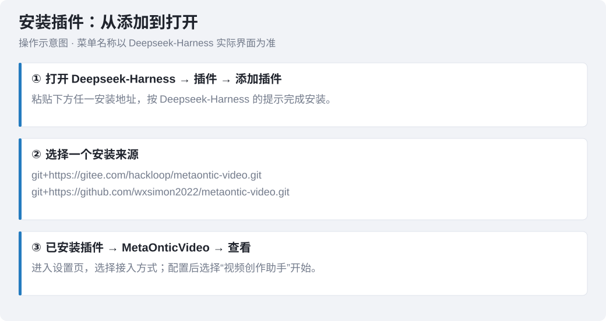
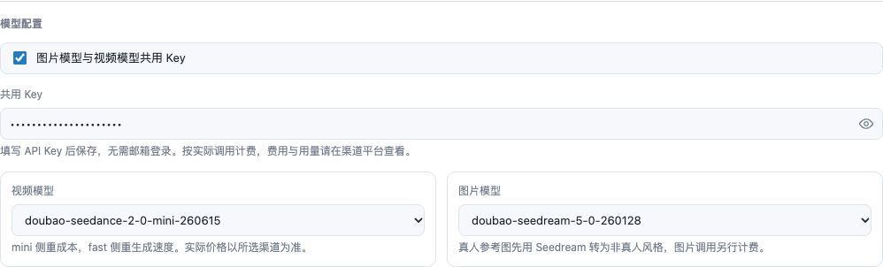
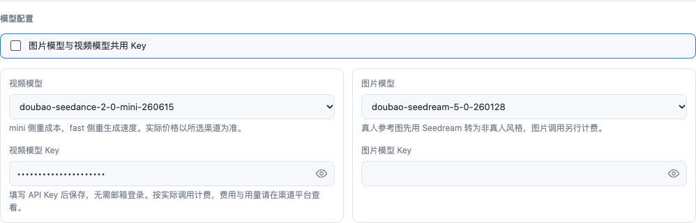
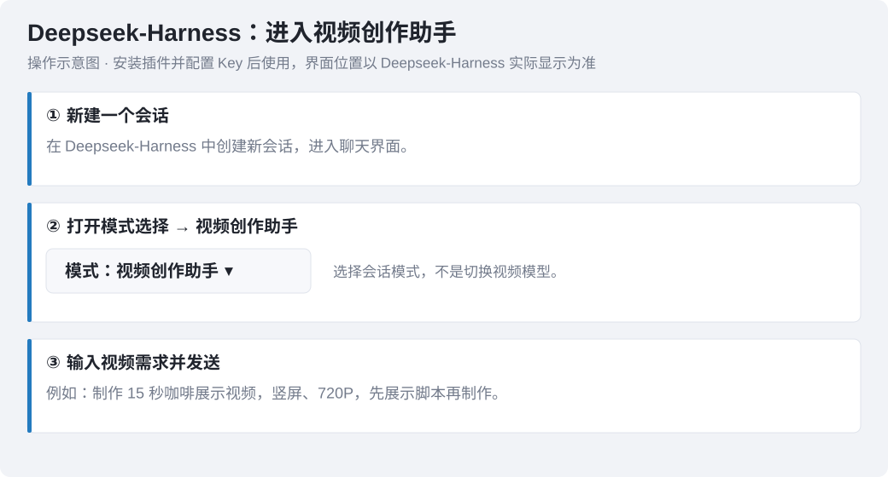
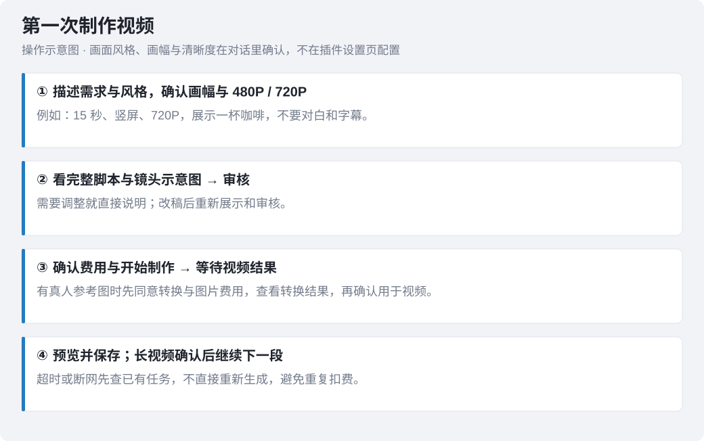
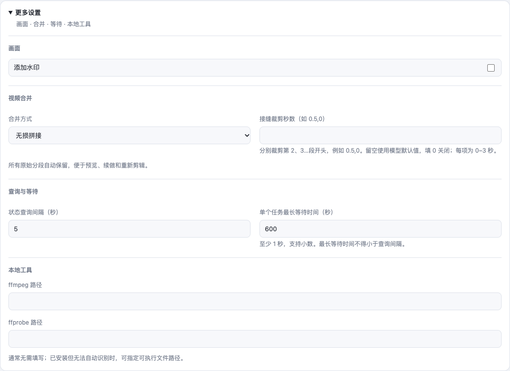

# MetaOnticVideo 安装与使用指南

先安装插件并配置 API密钥，再新建会话，将模式切换为“视频创作助手”，开始制作视频。API密钥配置配图来自插件真实组件的本地预览，使用模拟数据且密钥已隐藏；安装、会话与制作流程采用操作示意图，菜单名称以 Deepseek-Harness 实际界面为准。

MetaOnticVideo 是 DeepSeek Harness 的 AI 视频创作插件。使用 Seedance 2.0 制作超过15秒的视频时，会分段生成与续拍，逐段预览确认后在本地合并；完整制作流程见下文。

## 1. 如何安装插件



### 1.1 安装前准备

本教程同时适用于 **Windows 与 Mac（macOS）**。MetaOnticVideo 是 DeepSeek Harness 插件，需要先安装 DeepSeek Harness 桌面端，不能作为独立软件打开。

1. 从 DeepSeek Harness 的官方发布渠道获取对应系统的桌面安装程序，按安装向导完成安装；Mac 请按电脑芯片选择官方提供的对应安装包。
2. 打开 DeepSeek Harness，确认能正常进入桌面主界面并看到「插件」入口。
3. 准备可联网的环境及 API密钥；API密钥的申请与填写见第 2、3 节。

安装插件成品包不需要自行安装 Git、Node.js 或 Python。多段视频本地合并所需的 FFmpeg 可在开始使用后按需配置。

| 项目 | Windows | Mac（macOS） |
|---|---|---|
| 推荐安装方式 | 正式版 `.tgz` 附件链接或 Windows ZIP | 仓库地址安装；成品包作为备用 |
| 本地安装备选 | Windows ZIP 解压后的 `package`，或 `.tgz` 解压后的 `package` | `.tgz` 解压后的 `package` |
| 本地目录示例 | `C:\MetaOnticVideo\package` | `/Users/你的用户名/Applications/MetaOnticVideo/package` |
| 在线更新入口 | 插件详情 → 检查更新 | 插件详情 → 检查更新 |

### Mac 推荐：仓库地址安装

在 DeepSeek Harness「插件 → 添加插件」中粘贴下面任意一个地址，按提示安装并启用：

```text
git+https://gitee.com/hackloop/metaontic-video.git
```

或使用 GitHub：

```text
github:wxsimon2022/metaontic-video
```

仓库安装需要 Git 能访问对应站点。若拉取失败，可使用下面的成品包或本地目录方式。

### 1.2 在线安装：Windows 与 Mac 通用

1. 打开 [GitHub 正式版下载页](https://github.com/wxsimon2022/metaontic-video/releases/latest)，也可打开 [Gitee 发布页](https://gitee.com/hackloop/metaontic-video/releases)。
2. 在附件中找到 `metaontic-video-数字版本号.tgz`，右键复制该附件的下载链接。不要选择 Source code，也不要复制仓库地址或发布页地址。
3. 打开 DeepSeek Harness，进入「插件 → 添加插件」，粘贴刚才复制的 `.tgz` 下载链接，按提示安装。**在线安装的地址必须以 `.tgz` 结尾**；`MetaOnticVideo-Windows-数字版本号.zip`、解压出来的 `package` 文件夹、发布页网址和 Source code 源码包都不是在线安装地址，填进去会提示「不是有效的插件包」。
4. 安装后按软件提示启用插件，进入「插件 → 已安装插件 → MetaOnticVideo → 查看」，打开设置页。
5. 继续按第 2、3 节申请 API密钥、填写并保存，再按第 4 节开始创作。

此方式使用已构建成品，不通过 Git 拉取源码。只有 DeepSeek Harness 明确提示需要重启时才重启软件。

### 1.3 Windows 本地安装

可在正式发布页的附件中下载 `MetaOnticVideo-Windows-数字版本号.zip`。适合希望随包查看教程，或在线安装不方便的用户。本地安装仍需先安装 DeepSeek Harness，生成图片与视频仍需要联网。

**先记住：新安装选 `.tgz` 文件；恢复旧安装才复制 `package` 文件夹。**

最简单的操作顺序：右键 ZIP → 全部解压 → 找到 `.tgz`（不用再次解压）→ 复制这个文件的完整路径 → 打开 DeepSeek Harness「插件 → 添加插件」→ 粘贴路径 → 安装。若粘贴到界面的路径前后带英文双引号，删掉这两个引号再安装；终端命令里的引号则保留。

**使用 Windows ZIP 资料包：**

1. 右键安装 ZIP，选择「全部解压」。不要在 ZIP 预览窗口内安装。
2. 打开包内安装教程，找到 `metaontic-video-数字版本号.tgz` 成品文件。
3. 在 DeepSeek Harness「插件 → 添加插件」中填写该 `.tgz` 文件的完整绝对路径。解压后常出现两层同名文件夹，路径形如 `D:\software\MetaOnticVideo-Windows-数字版本号\MetaOnticVideo-Windows\metaontic-video-数字版本号.tgz`；层级和盘符以你电脑上的实际位置为准，建议右键 `.tgz` 选择「复制文件地址」，不要手打。
4. 按提示安装、启用，进入设置页配置 API密钥。由安装器管理插件文件，避免直接依赖外部解压目录。

安装框要填的是文件，不是文件夹。如果提示「不是有效的插件包」，通常是填成了文件夹：解压后的 `MetaOnticVideo-Windows` 外层文件夹和 `package` 资料目录都不是安装对象，请改填同目录下 `metaontic-video-数字版本号.tgz` 的完整文件路径。

若拿到的旧 ZIP 只有 `package` 目录，请从正式发布页另外下载 `.tgz` 成品，填写其完整本地路径安装；不要把 ZIP 或发布页地址填进安装框。

**也可以不下载到本地，直接粘贴成品地址：** 复制下面这条 Gitee 成品地址，粘贴到 DeepSeek Harness「插件 → 添加插件」即可安装，效果与填写本地文件路径相同，无需安装 Git。国内网络优先使用 Gitee。在线安装只认以 `.tgz` 结尾的附件地址；ZIP、`package` 文件夹和发布页网址只能用于本地安装，不能粘贴到在线安装框。

```text
https://gitee.com/hackloop/metaontic-video/releases/download/v3.15.2/metaontic-video-3.15.2.tgz
```

GitHub 同名地址为 `https://github.com/wxsimon2022/metaontic-video/releases/download/v3.15.2/metaontic-video-3.15.2.tgz`。正式版以 Gitee 发布页为主，GitHub 的同步可能晚一些；GitHub 上还没有该版本时用上面的 Gitee 地址。发布新版本后，把地址中的两处版本号换成发布页上的实际版本；也可以打开发布页，在附件中右键复制 `.tgz` 的下载链接。

- GitHub 正式版下载页：`https://github.com/wxsimon2022/metaontic-video/releases/latest`
- Gitee 发布页：`https://gitee.com/hackloop/metaontic-video/releases`

粘贴的必须是附件下载链接，不要填发布页网址，也不要选 Source code 源码包。Gitee 请使用上面的发布页地址，不要使用 `gitee.com/.../releases/latest`，该地址会直接下载源码包而不是插件成品。

**只有 `.tgz` 文件时：** 不必解压，直接使用本地文件完整路径安装。

**已有本地目录安装，更新报 `locale` 缺失或目录变空：** 先用完整成品恢复原安装路径下的整个 `package` 目录，确保 `package.json`、`index.js`、`client.js`、`locale` 和 `skills` 等内容齐全。不要只创建空的 `locale` 文件夹，不要重置 API密钥或删除任务记录。恢复后核对当前安装与更新状态；迁移成品安装来源时使用软件提供的安装/修复入口，若提示已安装则停止并保留错误，不先卸载。

### 1.4 Mac 本地安装

1. 从正式发布页下载 `.tgz` 附件。
2. 在 Finder 中双击解压；若得到 `.tar`，再双击解压。找到包含 `package.json`、`index.js` 的 `package` 文件夹。
3. 将安装目录放到固定位置，例如用户目录下的 `Applications/MetaOnticVideo`，避免留在会定期清理的临时目录。
4. 打开 DeepSeek Harness「插件 → 添加插件」，选择 `package` 文件夹；若使用地址输入框，填入其完整绝对路径。
5. 按提示安装、启用，进入设置页配置 API密钥。保留安装目录，不要随意删除或移动。

### 1.5 可选：终端安装

优先使用桌面端界面。以下命令仅适用于本机已经可以运行 `dsh` 的情况；提示找不到命令时，回到界面安装即可。

在线安装：将占位内容替换为实际 `.tgz` 附件下载链接，保留引号。

```text
dsh plugin --profile desktop add "复制的.tgz附件下载链接"
```

Windows PowerShell 本地安装：

```powershell
dsh plugin --profile desktop add "C:\MetaOnticVideo\metaontic-video-数字版本号.tgz"
```

Mac 终端本地安装：

```bash
dsh plugin --profile desktop add "/Users/你的用户名/Applications/MetaOnticVideo/package"
```

以上路径与文件名只是示例，Windows替换为实际 `.tgz` 文件路径，Mac目录安装替换为实际 `package` 路径。

### 1.6 安装是否成功

- 已安装插件列表中出现 MetaOnticVideo，状态为已启用。
- 点击「查看」可以打开插件设置，未提示组件启动失败。
- 配置 API密钥并保存后，新建会话可以选择「视频创作助手」。

安装报错先按第 5 节处理，不要为排查安装问题直接提交付费生成任务。

## 2. API密钥去哪里申请

插件的接入方式有两项：**MetaOnticVideo**（邮箱验证码登录，API密钥由服务端下发）和 **MetaOntic AI**（自行申请 API密钥）。火山引擎直连暂不在设置页提供，已保存过该项的安装仍可继续生成。

### 2.1 MetaOnticVideo（服务端登录）

1. 在接入方式中选择 **MetaOnticVideo**。
2. 在接入方式下方的登录区填入邮箱，获取邮件验证码并登录；登录成功后 API密钥由服务端自动写入，不需要手填。
3. 设置页显示账户**余额**：点「充值」按金额发起支付宝扫码付款，到账后余额自动更新；需要人工充值时点「客服」联系客服。点「刷新」可重新读取余额。在线充值可能被服务端关闭：此时设置页不显示「充值」，只提示联系管理员，按提示联系管理员或点「客服」人工充值即可。
4. 确认生成视频前，插件会弹一次人工确认，写明本次要调用的模型、清晰度、分段与预估费用，并显示当前账号余额；点「允许」才会真正调用模型。这一步不需要另外付款。
5. 如果剩余余额不够完成本次生成，插件会直接停下、不调用模型，也不会产生任何费用，并提示你先在设置页点「充值」按金额完成付款（或点「客服」人工充值），到账后再让助手重试同样的任务即可。

登录下发的 API密钥不要手填或替换；提示「不是服务端下发的」时，回到插件详情页重新点一次「登录」。

### 2.2 自行申请 API密钥（MetaOntic AI）

需要自行申请 API密钥时，目前按以下入口操作：

**[https://ai.bileego.com](https://ai.bileego.com)**

1. 打开网站，注册并登录账号。
2. 按网站当前页面指引获取 API密钥。
3. 确认账户可用额度，以及该 API密钥是否有你准备使用的视频、图片模型权限。
4. 回到插件，选择 **MetaOntic AI**，按下一节填写并保存。

申请到 API密钥后，在插件的接入方式中选择 **MetaOntic AI**。

API密钥只填写在插件密钥输入框内，不要放进脚本或发到聊天中。

## 3. 选择 MetaOntic AI 并配置 API密钥

1. 在接入方式中选择 **MetaOntic AI**。
2. 根据下面两种情况配置 API密钥。
3. 选择视频模型和图片模型，完成后点击保存。

切换接入方式并填好 API密钥后，点击一次保存并等待保存结果；后台正在同步时会等待同步完成。若提示保存失败，草稿会保留，请按提示处理后重试。

**情况一：两个模型共用一把 API密钥**



保持开启「图片模型与视频模型共用 API密钥」。在两个模型上方的 **共用 API密钥** 中填写从网站获取的 API密钥，再选择视频模型和图片模型。这把 API密钥必须同时支持你选择的两种模型。

共用开关和共用 API密钥位于两个模型上方。宽窗口中，视频模型与图片模型左右分组；窄窗口自动上下排列。

**情况二：视频和图片分别使用 API密钥**



关闭「图片模型与视频模型共用 API密钥」：

- 在视频模型下方的 **视频模型 API密钥** 中填写视频用 API密钥。
- 在图片模型下方的 **图片模型 API密钥** 中填写图片用 API密钥。

排列顺序：共用开关 → 视频模型 → 视频模型 API密钥 → 图片模型 → 图片模型 API密钥。

独立图片 API密钥未填写时，图片调用会停止并提示补填，不会自动改用视频 API密钥。图片提交、查询和取件均使用图片 API密钥；视频生成、重试和状态查询使用视频 API密钥。

两个模型仍沿用当前 MetaOntic AI 接入地址，分别填写 API密钥不代表分别配置接口地址。MetaOntic AI 按渠道账户实际调用计费。

## 4. 在 Deepseek-Harness 中开始使用



安装插件并保存 API密钥配置后，按以下步骤进入视频创作：

1. 在 Deepseek-Harness 中**新建一个会话**。
2. 打开会话的**模式选择**，将模式改为 **视频创作助手**。
3. 在输入框中描述你要制作的视频；需要参考图时，在会话中上传图片并说明用途。
4. 发送需求后，按助手提示确认清晰度、审核脚本，再确认是否开始制作。

这里的“视频创作助手”是会话模式，不是插件设置里的视频模型。若模式列表里没有它，先检查 MetaOnticVideo 是否已安装并启用，再重新打开模式列表；只有 Deepseek-Harness 提示需要重启时才重启软件。

### 第一次生成视频



切换到「视频创作助手」后，可以直接说：

> 帮我做一个 15 秒的咖啡展示视频，竖屏，720P，温暖自然，不要对白和字幕。先展示脚本，审核后再制作。

操作顺序：

1. 描述需求或提供完整方案。需要助手完善时直接说“帮我完善”；已有完整方案时可要求“只润色，不改变剧情、角色和结尾”。
2. 确认画面风格：没有指定风格时，助手会按你的创意推荐几款合适的画面风格，选一款即可；已经说清风格（例如“真实自然”“二维动画”）或说“你定”时直接采用，不会反复推荐。选定后助手按这个方向完善创意并写脚本。
3. 确认画幅与清晰度：画幅按 **16:9 横屏 / 9:16 竖屏** 确认，清晰度支持 **480P、720P**，都在脚本阶段选择，不在插件设置页配置。本次需求已写明某一项就不重复询问；两项都没指定会合并成一次提问。未回答或取消时不开始制作。时长未指定时默认 15 秒。
4. 未提供图片且需要固定角色时，先选择是否生成角色参考图（图片单独计费）；同意后先看图审核，不同意则继续纯文生视频。随后查看完整脚本和正文里的镜头示意图，再确认脚本是否通过。图下会提供打开原图的链接；审核前会检查本轮是否已在正文插入本版分镜图——只登记到文件卡片不算让用户看到图，改稿后贴的还是上一版图也会被拦下——未完成时提示助手先补展示。若界面仍未显示图片，可打开原图并告诉助手补展示。示意图不是实际成片，默认不调用付费出图模型。
5. 费用在写脚本时一并算出：完整脚本末尾的“费用预估”一节会展示“火山官方方案”和“MetaOnticVideo插件方案”两项人民币基础估价，以及各自模型、分段和价格依据。火山官方方案统一按 Seedance 2.5 计算：单段上限 30 秒，不足 30 秒按实际秒数计，不凑整；超过 30 秒按 30 秒直出加逐段续拍如实列出，续拍计入上一段完整视频输入。费用明细逐段显示：首段为无视频输入，后续续拍为有视频输入；续拍按上一段完整视频时长加本段输出时长估算，并使用含视频输入单价；参考图片不算视频输入。最低用量补足尚未计入，图片处理、重试及独立配音另计，实际以账单为准。未核实账户折扣时不默认套用优惠；不同模型效果也有差异。脚本通过后，单独确认费用与是否开始制作。按 MetaOntic AI 渠道账户实际调用计费。
6. 等待生成，预览并保存结果。等待时工具卡片显示按等待时长估算的进度、一条装饰用的小乌龟（跟着进度从左往右爬）和执行中的呼吸灯边框，它们只表示“还在生成”，不是上游的真实完成比例；确认成功后才到 100%。完成后会显示中转站结算的实际视频费用；分段暂停时显示已生成部分，尚未结算时显示“待结算”。可按原任务ID补查，不需要重新生成。图片处理及额外重做另计。长视频分段续做沿用已确认的清晰度，例如 30 秒选择 480P，后续分段的制作确认与生成均保持 480P。改稿后需要重新展示、审核并确认制作；普通改稿保留已确认清晰度，改变清晰度须重新确认。

### 审核续拍过渡

续拍方式由脚本设计决定，不在插件设置中配置。请在审核时确认每段采用连续镜头还是切换近景、中景等景别，制作时按已确认的安排执行。

脚本先定义人物、道具与场景的统一称呼，再按事件顺序写清各镜头的动作、景别、视角、运镜和声音；画质与约束词按需求填写，不能代替已确认的480P或720P参数。

长视频脚本会列出各段之间的过渡画面描述：前一段人物和动作停在哪里、下一段如何接上、镜头是否切换、声音如何延续。请与脚本一起核对；不满意时在制作前修改并重新审核。

例如：男子已放下茶杯，承接其抬眼动作，切到女子近景回应，室内环境声和配乐连续。脚本会同时说明主体、动作、场景、光影、镜头、风格、画质与约束；中景、近景、视角和运镜按剧情安排，不因分段自动换地点。过渡描述有助于表达衔接意图，仍需预览实际效果。

### 使用参考图

上传图片并说明用途，例如“用这张图保持人物外观”或“这张作为视频第一帧”。多图需说明各自对应的人物、商品或场景；参考图与首尾帧模式不能混用，尾帧必须配首帧。

真人参考图需要先确定非真人风格，并征得你对图片处理及其费用的同意。处理完成后先展示全部转换图，等你核对并确认后再用于视频。图片生成单独计费；效果不合适或仍像真人时停止，不使用原真人图重试。

视频接口返回明确真人限制时，也遵循“同意转换 → 看转换结果 → 确认重试”流程，最多重试视频一次；图片与视频重试分别计费。部分图片已完成时会保存结果，续做不从头处理。

图片模型为 `doubao-seedream-5-0-pro-260628`（旧型号已下线），能否调用以 API密钥的实际模型权限为准。

### 长视频与中断恢复

超过模型单次上限时，插件分段制作。每段完成先展示视频，你确认后再继续下一段。Seedance 2.0 单次 4–15 秒；2.5 保留兼容，但设置页暂不提供新候选。

说“继续”后、提交下一段之前，会先弹一次确认框，写明第几段已经生成好、接下来做第几段、整条还差多少秒和大概还要花多少。点“允许”才继续；点“拒绝”就先停在这里，已经生成好的分段不用重做，之后随时能接着做。

暂停后可说“接着刚才的进度继续，不要重做已完成片段”。超时、断网不一定表示生成失败，先查原任务，避免重新提交。

提交结果不明时插件会阻止重复提交。保留返回的任务或提交记录，让助手协助核对渠道记录；找到原任务则继续查询，只有你在渠道确认没有创建任务后才能解锁。不要通过修改参数或清除记录绕过防重。

未完成任务继续使用原来的参数与连接配置；请保留原接入方式、地址和 API密钥，不要在等待期间切换。同一份暂停进度不要同时续做多次。

### 对话范围与配置修改

这个会话只做视频创作：脚本与分镜、生成与接长、合并与交付，以及完成这些必需的配置指引和环境排查。与视频创作无关的话题（其他软件的安装排障、写代码、通用问答、闲聊等）不会展开——助手会说明这里只做视频创作，请回到视频需求。

插件配置（接入方式、API密钥、模型、地址、时长等）只能在设置页里改：打开「插件 → 已安装插件 → MetaOnticVideo → 查看」，改完点「保存」，宿主重载后生效。在对话里说“把模型改成 X”“把地址换成 Y”不会生效，助手只核对当前配置并引导你到设置页操作；助手不会向你索取或展示 API密钥。

### 更新插件

Windows 与 Mac 的更新入口相同。`.tgz` 成品安装或仓库安装可使用此入口；本地目录链接安装会先停止直接替换，避免外部目录异常：

1. 等正在执行的视频任务完成。
2. 打开「插件 → 已安装插件 → MetaOnticVideo → 查看」，找到底部版本卡片，点击「检查更新」。
3. 发现更高的正式版本后，点击更新并再次确认，等待安装结果。
4. 按界面提示完成；只有明确提示需要重启时才重启，不需要先卸载。

在线更新需要能访问发布页及附件下载地址，使用对应版本 `.tgz` 成品包，不依赖 Git 拉取。下载失败时先保留现有插件和配置，核对网络后再处理，不要通过重置来解决下载问题。

插件详情底部的版本卡片提供“检查更新”。发现更高的正式版本后，点击更新并再次确认才安装。请等正在生成的视频结束后再更新，配置及已生成文件会保留，不需要先卸载。当前不提供版本选择或降级；在线安装使用对应版本成品包，当前版本不需要授权 esbuild 等构建工具的安装脚本。

## 5. 结果保存与常见问题

生成结果默认保存在当前会话工作目录下的 `metaontic-video/`，助手会展示视频，并在正文提供可点击的文件链接。脚本、分镜图、转换图片和恢复后交付的文件也会提供打开链接；图片还会在正文展示。超过15秒且分段生成时，等整条视频生成结束、成片在本机合并成功后，助手会把合并成片放在交付卡片的第一个位置，再依次列出第一段、第二段及后续全部分段。脚本、分镜示意图、参考图、转换图片、单段预览和暂停时的部分合并都算过程材料，只在正文展示，不放进交付卡片：卡片按本轮首次出现的顺序排列、超过四项还会折叠，中途登记会把成片挤到后面，事后补发也挪不回来。助手若把分段排在成片前面、漏掉成片或带上中间版本，插件会拦下这次登记并要求按提示重发；暂停、部分交付或还在等待查询时也不会登记卡片。成片另存为别的文件名或换到 final 等目录也照样按成片判定，不会因为改名而放过顺序错误。暂停时先交付已完成分段，合并失败时说明原因并保留分段。原始分段保留，脚本等资料通常在 `video-projects/<项目名>/`。如只返回上游链接，需在链接失效前保存。

多段本地合并需要 ffmpeg；缺少时可说“帮我检查并安装 ffmpeg”，确认安装后继续。高级设置中的合并、裁剪、等待时间通常保持默认即可；裁剪可能缩短成片，原始分段不删除。

需要重新配置时，可使用“重置插件”清除设置、密钥和登录状态；已生成的视频不会删除。

| 遇到的问题 | 如何处理 |
| --- | --- |
| 网站申请的 API密钥不知道填哪里 | 选择 MetaOntic AI；共用时填“共用 API密钥”，不共用时分别填两个模型下方的 API密钥 |
| 图片提示缺少 API密钥 | MetaOntic AI 关闭共用后必须填写图片模型 API密钥并保存 |
| 提示无权调用模型或鉴权失败 | 检查对应模型的 API密钥是否正确、是否开通模型权限，修改后保存 |
| 提示额度不足、已停止调用 | 用 MetaOnticVideo（服务端登录）时是当前账号余额不够：在设置页点「充值」按金额付款，或点「客服」人工充值，到账后再让助手重试；设置页没有「充值」按钮说明服务端已关闭在线充值，联系管理员或点「客服」即可；插件在额度不足时不会调用模型、没有产生费用。用 MetaOntic AI 时是当前 API密钥的余额不够：到对应平台按指引给这把 API密钥充值（本站不参与，也不显示余额） |
| 生成前要确认什么 | 插件会写明本次调用的模型、清晰度、分段与预估费用，点「允许」才开始；MetaOnticVideo 会一并显示当前账号余额，余额不足会先停下提示充值（设置页没有「充值」按钮时改为提示联系管理员），全程不需要另外付款 |
| 只生成第一段 | 先预览本次成果，再在确认框里点“允许”从暂停进度继续 |
| 超时、网络失败或提交结果不明 | 保留原任务与记录，先查询或核对，不直接重新生成 |
| 只给脚本文件就要求审核 | 要求先完整展示当前版脚本和镜头示意图，再重新审核 |
| 展示脚本后没有弹出审核窗口 | 助手偶发在展示正文后提前结束这一轮，审核窗口不会出现。直接在对话里回一句（例如“重新弹一下审核窗口”或直接说修改要求）；助手会先补弹当前版脚本审核窗口，再按你的要求改稿。已展示的脚本、分镜图和已确认参数都不会丢 |
| 没有清晰度选项 | 清晰度在对话里的脚本阶段确认，支持 480P / 720P |
| 没想好画面风格 | 只说创意即可：助手会按创意推荐几款合适的画面风格，选一款后按这个方向完善创意与脚本；已经说清风格或说“你定”时直接采用，不会反复推荐 |
| 组件启动失败或提示缺少依赖 | 使用正式安装包；曾配置本地开发时，检查是否仍指向已删除的本地源码目录 |
| 想让助手在对话里改模型 / 地址 / API密钥 | 配置改动只在设置页生效：打开「插件 → 已安装插件 → MetaOnticVideo → 查看」改完保存。对话里的配置工具只读，助手只会核对当前配置并引导你去设置页 |
| 问和视频无关的问题 | 这个会话只做视频创作，无关话题不展开；把问题换成视频需求，助手会继续帮你 |
| 保存失败 | 输入会保留。配置冲突时核对最新设置后重试；连接中断时先重新打开设置核对是否已保存。后台取回 API密钥时会等待写入完成；仅在软件明确提示需要重启时重启 |

保存配置时，插件会一并保存接口地址、模型和请求路径；未填写地址时使用 MetaOntic AI 默认地址。密钥仅用于所选连接，图片独立密钥不会替代视频密钥。

排查处理缓慢时，可查看 `~/.dsh/logs/metaontic-video/日期/requests.jsonl` 中的阶段耗时；设置了 `DSH_HOME` 时日志位于该目录下。插件会记录调用、生成等待、下载、合并和费用查询耗时；脚本设计、示意图与等待用户确认由助手标记开始和结束，其中脚本保存为 `script.md` 时插件会自动结束脚本设计这一段，并另记一条 `script_saved`（文件名、新建或改写、字数与脚本版本）。这些是流程耗时，并非模型纯推理时间；只有开始记录时表示该阶段未完整结束。写脚本、画分镜本身是助手和模型在做事，不属于插件耗时。日志不包含密钥或完整提示词。

设置页按接入与密钥、模型配置、画面与声音分组；画面比例和声音开关在宽窗口并排显示，窄窗口上下排列。服务端登录表单位于接入方式下方，重置入口位于设置页底部。

“更多设置”展开后分为画面、视频合并、查询与等待、本地工具四组；本地工具路径单独占一行，便于查看和填写完整路径。



续拍时，插件会持续带上最初已审核的角色参考图，帮助保持人物外形。未单独指定角色图时沿用最初参考图或首帧；暂停后继续也保留同一套图。若图片已按你的确认转换为非真人风格，后续沿用获审并成功使用的转换图，不重复处理。纯文字起步且没有图片时不会自动生成角色图；需要固定形象时，请在制作前提供并审核角色图。

纯文生视频需要固定人物外形时，助手会先询问是否生成角色参考图，并说明图片单独计费。选择直接文生视频就不生成图片；选择生成时先确认角色与画面风格，出图后先展示给你审核，满意后才用于视频首段与后续续拍。角色图费用与视频费用分开，生成角色图不代表同意开始制作视频。超时先查询已有图片任务，不重复出图；重画需再次确认费用。

提交新的纯文生视频时，插件会强制显示角色图选择。选择“直接文生视频”后再确认视频费用；选择“先生成角色图”则先出图、审核后再制作。未回答、关闭或取消不会自动开始；相同任务的明确选择会保留，已有参考图或续拍恢复不重复询问。

### 安装与更新故障排查（Windows / Mac）

| 现象 | 处理方法 |
|---|---|
| `ERR_PNPM_GIT_RESOLVE_FAILED` | 检查是否仍使用 Git 仓库地址。改用正式版 `.tgz` 附件链接或本地 `package` 目录。无需全局 Git 地址重写或配置 SSH。 |
| `Lockfile passes supply-chain policies` 后又报错 | 这句表示供应链检查通过，实际失败原因在后面的错误。保留完整错误信息。 |
| 找不到本地插件或 `package.json` | 确认已经解压，并选择包含 `package.json`、`index.js` 的 `package` 目录。 |
| 附件下载失败或超时 | 核对网络，换同一版本的另一个官方发布源；也可通过浏览器下载后本地安装。不要使用 Source code 代替成品包。 |
| 在线安装提示「不是有效的插件包」 | 在线安装的地址必须以 `.tgz` 结尾，请用 `.tgz` 附件下载链接；`MetaOnticVideo-Windows-数字版本号.zip`、解压后的 `package` 文件夹、发布页网址和 Source code 都不是在线地址，本地安装请另按 1.3 节填写文件路径。 |
| 在线或本地安装报 `ERR_PNPM_MISSING_TARBALL_INTEGRITY` | 插件安装目录里早先安装留下的 `pnpm-lock.yaml` 缺少校验值，新版 pnpm 会拒绝安装，与插件包本身无关。插件已安装时会每 2 秒检查一次并自动清理这条记录，更新失败后也会等清理完成自动重试；仍不行或还没装上插件时，按本节「安装报 ERR_PNPM_MISSING_TARBALL_INTEGRITY」手动处理后再装。 |
| 提示找不到 `dsh` | 使用 DeepSeek Harness 桌面端的插件安装入口。 |
| 组件启动失败、`ERR_MODULE_NOT_FOUND` 或 Schema 错误 | 保留完整错误及插件版本，确认安装的是成品包；曾配置本地开发加载路径时需核对是否仍覆盖正式安装目录。不要先清除 API密钥或任务记录。 |
| `ERR_PNPM_IGNORED_BUILDS` / esbuild 脚本提示 | 核对是否误用了源码或旧 Git 安装来源，改用成品包；不要关闭供应链检查或直接批准未知构建脚本。 |
| 更新失败 | 保留现有插件、API密钥及已生成文件，记录目标版本与完整错误，检查附件可访问性；不要先卸载或重置。 |

排查时可以提供系统类型、插件版本、安装来源和完整错误文字；不要发送 API密钥、登录验证码或包含密钥的配置文件。

### 安装报 `ERR_PNPM_MISSING_TARBALL_INTEGRITY`

报错原文形如：

```text
Cannot install package "metaontic-video@https://…/metaontic-video-版本号.tgz":
its lockfile entry has no "integrity" field, so pnpm cannot verify the downloaded tarball.
```

这条报错与插件包本身无关。DeepSeek Harness 的插件安装目录里保留了早先安装生成的 `pnpm-lock.yaml`，其中这条 `.tgz` 地址的记录没有写入校验值；当前 pnpm 为防安装被篡改会直接拒绝，因此在删掉这条记录之前，换成在线地址、换成本地 `.tgz` 路径或重装旧版本都会同样失败。

处理步骤：

1. 完全退出 DeepSeek Harness。
2. 删除插件安装目录里的 `pnpm-lock.yaml`。Windows 在文件管理器地址栏输入 `C:\Users\你的用户名\.dsh\profiles\desktop` 打开该目录；Mac 打开 `~/.dsh/profiles/desktop`。设置了 `DSH_HOME` 时改到该目录下的 `profiles/desktop`。
3. 重新打开 DeepSeek Harness，按 1.2 节或 1.3 节再安装一次。安装器会重新生成 `pnpm-lock.yaml` 并写入校验值。

插件运行期间还会每 2 秒检查一次这个文件：一旦发现里面留着本插件缺少校验值的记录（包括旧版本留下的、已经没人引用的记录），会自动删掉本插件这条并把原文件另存为同目录下的 `pnpm-lock.yaml.metaontic-backup-时间`，不需要你手动处理。更新时出现这条报错，插件会等清理完成自动重试一次，多数情况下接着就能继续；只有当插件本身还没装上、后台还没有这个清理动作时，才需要按上面的步骤手动删除。

只删除 `pnpm-lock.yaml`，不要删除同目录的 `package.json`。该文件只记录依赖版本与校验值，删除后重新安装即可，已保存的插件设置不受影响。

### 本地目录安装点击更新后目录变空

如果报错仍指向原先解压的 `package` 目录，请停止重复点击更新。用完整安装包恢复原路径下的整个目录，不只补一个空locale文件夹，也不要重置 API密钥或删除任务记录。

插件更新前会读取安装来源：本地目录链接、来源无法核实或元信息异常时停止，不调用安装器。它不会自动修复此前已变空的目录，也不会静默迁移旧安装。新装推荐使用 `.tgz` 成品文件；旧目录安装迁移需要先核对实际加载路径和配置保留情况，不能只把目录恢复后再次点击旧版“立即更新”，也不要直接卸载。

自动检查覆盖成品安装及成品升级，不等于旧本地目录迁移或桌面界面的实机验收。遇到拦截请保留错误与安装来源，进一步排查，不绕过保护。
