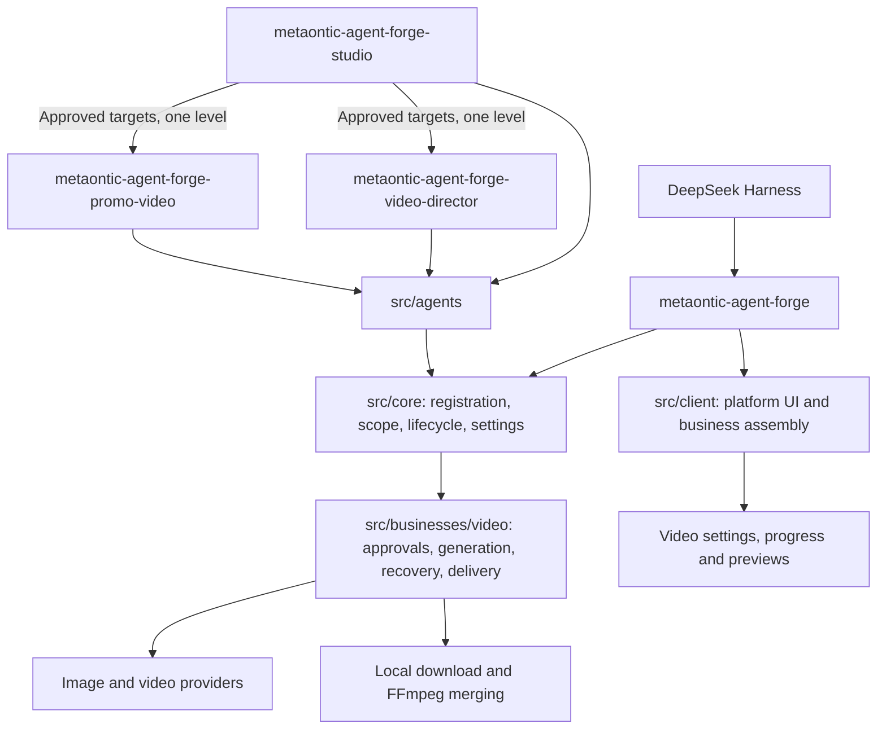

# MetaOntic Agent Forge

[简体中文](./README.md) · [Gitee](https://gitee.com/hadlooop/metaontic-agent-forge) · [GitHub](https://github.com/wxsimon2022/metaontic-agent-forge)

An extensible agent platform for DeepSeek Harness. The coordinator delegates tasks and summarizes results; specialist agents execute independently assembled business workflows.

## Agents

| Agent | ID | Role |
|---|---|---|
| 云智工坊 · 智能体平台 | `metaontic-agent-forge-studio` | Coordination, task tracking and result summaries |
| Video creation assistant | `metaontic-agent-forge-video-director` | Concepts, scripts, generation and continuation |
| Promotional video assistant | `metaontic-agent-forge-promo-video` | Product, brand and event videos |

Delegation is limited to approved specialists and one level. Task creation is not completion. Users still review scripts, costs and each generated video segment.

Specialists report progress and results through the host messaging channel. Answer review requests in the specialist task, then continue that same task.

## Available business: video creation

- **Beginner-friendly creation**: guided ideas, scripts and previews. Reuse specifications already provided by the user.
- **A low-cost long-video workflow**: generate segments, continue them and merge locally; retain completed work and resume saved progress.

Bring your own API key. Image/video calls are billed by the provider; local merging uses FFmpeg.

## Online installation

<!-- forge:installation:start -->
Paste a package URL into Harness → Plugins → Add plugin:

Gitee: https://gitee.com/hadlooop/metaontic-agent-forge/releases/download/v1.0.0/metaontic-agent-forge-1.0.0.tgz

GitHub: https://github.com/wxsimon2022/metaontic-agent-forge/releases/download/v1.0.0/metaontic-agent-forge-1.0.0.tgz
<!-- forge:installation:end -->

Git SSH remote addresses are for source control and should not be entered in the plugin installation field. Open Cloud Studio from the sidebar, or select the platform coordinator in the conversation mode menu. Specialists remain available for internal delegation and are not listed as selectable modes.

## Architecture

[Online guide](https://ai.mybfs.cn) · [Adding agents and businesses](./docs/engineering/structure-refactor.md) · [Development](./docs/engineering/development.md) · [Issues](https://github.com/wxsimon2022/metaontic-agent-forge/issues)

See [LICENSE](./LICENSE).
