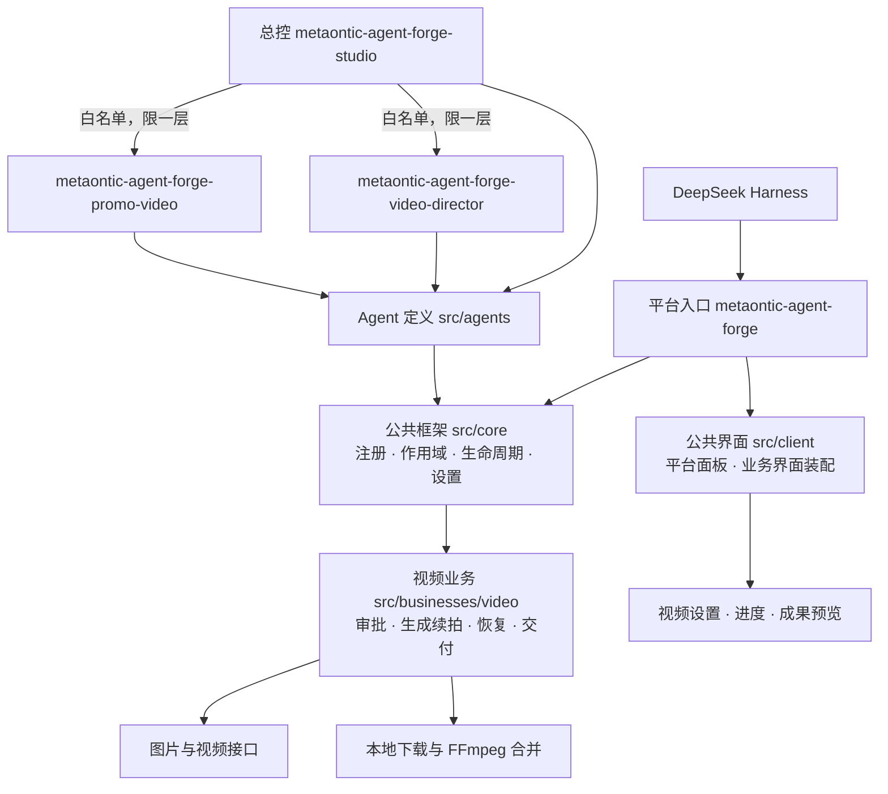

# 云智工坊 · 智能体平台

[English](./README.en.md) · [Gitee](https://gitee.com/hadlooop/metaontic-agent-forge) · [GitHub](https://github.com/wxsimon2022/metaontic-agent-forge)

**MetaOntic Agent Forge** 是 DeepSeek Harness 智能体平台：总控负责理解需求、委派与汇总，专业 Agent 负责业务执行，公共框架支持独立扩展业务。

## 三个 Agent

| Agent | ID | 职责 |
|---|---|---|
| 云智工坊 · 智能体平台 | `metaontic-agent-forge-studio` | 总控调度、任务跟进、成果汇总 |
| 视频创作助手 | `metaontic-agent-forge-video-director` | 创意、脚本分镜、视频生成与续拍 |
| 宣传视频助手 | `metaontic-agent-forge-promo-video` | 产品、品牌、活动的宣传视频 |

总控只调用白名单中的专业助手，最多一层委派。启动任务不等于生成完成；脚本、费用与每段视频结果仍由用户审核确认。

## 当前业务：视频创作

- **新手快速上手**：说出想法，按指引完善创意、审核脚本、预览结果；已明确的时长、画幅和清晰度不重复询问。
- **低成本长视频方案**：分段生成、逐段续拍、本机合并，复用已完成分段，支持暂停与续做。

视频业务需要配置自己的 API密钥，图片与视频按渠道实际用量计费。本地合并使用 FFmpeg。

## 在线安装

<!-- forge:installation:start -->
在 Harness「插件 → 添加插件」中填写以下成品链接：

Gitee: https://gitee.com/hadlooop/metaontic-agent-forge/releases/download/v1.0.0/metaontic-agent-forge-1.0.0.tgz

GitHub: https://github.com/wxsimon2022/metaontic-agent-forge/releases/download/v1.0.0/metaontic-agent-forge-1.0.0.tgz
<!-- forge:installation:end -->

Git 仓库 SSH 地址用于代码拉取和推送，不能直接填入 Harness 插件安装框。配置完成后，可从左侧“云智工坊”进入总控，也可在会话模式中直接选择专业助手。

## 插件架构

[在线使用说明](https://ai.mybfs.cn) · [扩展 Agent 与业务](./docs/engineering/structure-refactor.md) · [开发说明](./docs/engineering/development.md) · [问题反馈](https://github.com/wxsimon2022/metaontic-agent-forge/issues)

许可见 [LICENSE](./LICENSE)。
