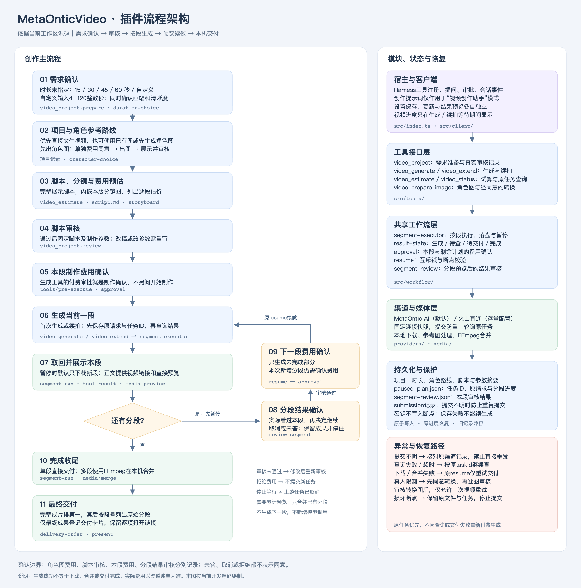

# 插件流程架构

基于当前工作区源码绘制，包含尚未发版的时长确认与流程重构。

- [PNG预览](./plugin-workflow.png)
- [PDF分享版](./plugin-workflow.pdf)
- [SVG矢量图](./plugin-workflow.svg)
- [可编辑Mermaid源码](./plugin-workflow.mmd)

主流程由`metaontic_agent_forge_video_project`管理需求与审核，`metaontic_agent_forge_video_generate`和`metaontic_agent_forge_video_extend`构造不同请求，共用`segment-executor`处理执行、落盘及逐段暂停。`result-state`统一解释结果阶段，`segment-run`负责下载与合并收尾。客户端将运行进度和成果预览分开呈现。

新创作缺少时长时先询问并保存选择，已有明确时长不重复询问。图片生成、脚本审核、视频费用与分段结果审核是不同确认边界；阶段不能互相代替。生成工具返回视频后才单独做分段结果审核，不在生成循环中阻塞等待用户。

外部服务只包括所选生成渠道及其查询接口，本地媒体由FFmpeg处理。旧的插件服务端登录、余额及充值不属于当前插件流程。查询、交付或费用查询失败不能触发重新生成；停止本地等待不证明上游任务已取消。
